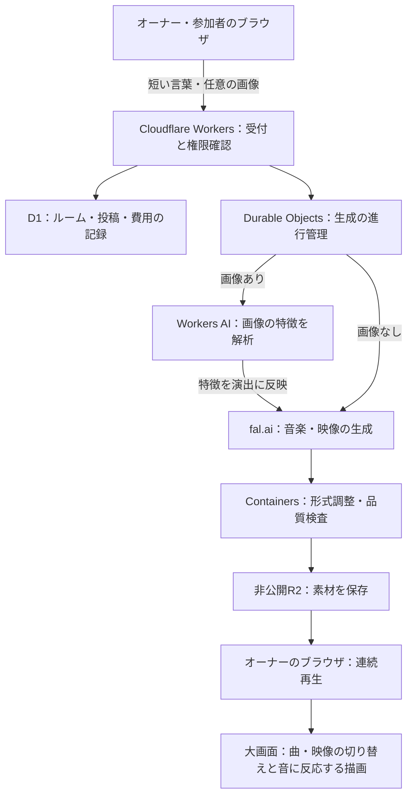

# AI VDJ — みんなの言葉で、音と映像を。

**参加者のひとことが、会場の音楽と映像になる。**

AI VDJは、参加者が投稿した言葉や画像から音楽と映像を生成し、ブラウザの大画面で連続再生する、参加型のDJ・VJサービスです。
オーナーが開いたルームにスマホから参加し、その場のアイデアを演出へ加えられます。
1人で自分だけのセッションを作ることも、複数人で会場の雰囲気を変えていくこともできます。

**[本番サービスを開く](https://ai-vdj-devdaycommunity.hapx2yuki.workers.dev/room)**

インストール、APIキーの入力、Macとの接続は不要です。ルームの作成から投稿・生成・再生まで、ブラウザだけで体験できます。
大画面で再生する端末はPCのChromeをおすすめします。参加者向けにはスマホから使える投稿画面を用意しています。

[使い方](#審査体験用の使い方) · [体験の見どころ](#体験の見どころ) · [技術構成](#技術構成) · [確認済みの範囲](#確認済みの範囲)

## どんな体験を作るのか

会場で音楽を聴き、映像を眺める人が、自分のアイデアを演出へ加えられるようにします。
専門的な音楽用語や長い生成指示は必要ありません。「宇宙を走る重低音」のような短い言葉から、サービス側が音作りと映像の演出を組み立てます。

たとえば、オーナーが「ネオンの猫が踊る」と投稿して再生を始め、別の参加者が「液体金属の宇宙」と投稿すると、完成した音楽と映像が次の演出へ加わります。
画像を添えれば、そのキャラクターや人物の特徴を生かした映像にも展開できます。
生成・待ち時間・切り替えまでを、一つの会場体験として設計しています。

| 体験の特徴 | 利用者にとっての意味 |
| --- | --- |
| 短いプロンプトで参加 | 詳しい生成指示を書かずに、自分のアイデアを送れます |
| 画像は任意 | 言葉だけでも成立し、画像があれば被写体の特徴を演出へ加えられます |
| 音楽と映像を一緒に生成 | 一つの投稿から、そのイメージに沿う音と映像を作ります |
| 音楽の流れを保つ | 60秒の音楽に対して映像を複数用意し、視覚的な変化を続けます |
| 生成待ちでも演出を継続 | 再生開始後は、手元にある音楽と承認済み映像を使って次の完成を待てます |
| ブラウザだけで利用 | 専用アプリや生成サービスのアカウントを利用者に求めません |

## 審査・体験用の使い方

1. **ルームを作る**

   [本番サービス](https://ai-vdj-devdaycommunity.hapx2yuki.workers.dev/room)を開き、「ルームを開く」を押します。その端末がオーナーの再生画面になります。
2. **参加者を招待する**

   オーナー画面のQRコードを読み取るか、「URLをコピー」で参加用URLを共有します。参加者は呼ばれたい名前を入力し、「参加する」を押します。
3. **プロンプトと、任意で画像を投稿する**

   「ネオンの猫が踊る」「宇宙を走る重低音」など、短い言葉を入力します。画像を使う場合だけ「参考画像（任意）」から添付し、「このアイデアを送る」を押します。画像なしでも生成できます。オーナー自身も「音楽・映像を生成する」から投稿できるため、1人でも試せます。
4. **生成を待つ**

   オーナー画面の「自動生成 ON」を確認します。OFFの場合はボタンを押してONにします。投稿から音楽と映像が生成され、「届いたアイデア」に進み具合が表示されます。生成には数分かかる場合があります。
5. **音楽と映像を大画面で楽しむ**

   準備完了後、オーナー画面で「再生する」→「大画面にする」を押します。音楽を流しながら、生成映像と準備済みの映像が順に切り替わります。

### おすすめの試し方

- **言葉だけで試す**：「宇宙を走る重低音」で、共通のDJ・VJ演出と投稿したテーマの組み合わせを確認します。
- **画像を添えて試す**：キャラクターなどの画像に「ネオンのステージで踊る」と添え、被写体の特徴と動きが映像へどう反映されるかを見ます。
- **2人以上で試す**：1台を再生画面、もう1台を参加者画面にして、投稿から生成・演出への追加までを体験します。
- **再生を続けて試す**：曲の切り替え、複数の映像、生成待ちの間の演出を通して確認します。

1ルームで最大5曲を生成できます。再生中はオーナーのタブを開いたままにしてください。
全画面の解除は**Esc**、再生の停止は「音を止める」です。
生成費用は運営側が負担し、参加者への請求はありません。審査用の受付期間・生成枠には上限があります。

## 体験の見どころ

### 1. 音楽が盛り上がる時間を確保する

1曲を60秒とし、導入から展開、盛り上がりの維持までを含む制作指示を用意しています。
EDM・サイケデリックトランスを軸に、共通の制作方針として140 BPM・4拍子・A minorを指定します。
キックとベースの重なり方、低域の厚み、細かな打楽器の変化、印象的な短いフレーズも指示に含めます。
これらは生成モデルへの制作指示であり、すべての出力が指定どおりになる保証ではありません。

ブラウザ側では、次の曲を音声の時計に合わせて予約し、1.5秒かけて重ねながら切り替えます。
その際は低域も受け渡し、曲の重なりによる低音の過密を抑えます。
次の曲が未完成の場合は、現在の音楽をつないで再生を継続します。

実装：[音楽の制作指示](cloud/cloudflare/creative-direction.mjs) / [連続再生と曲の切り替え](room-web/judge-player.mjs)

### 2. 同じ映像を眺め続けない構成にする

1曲につき、1080P・12秒の異なる映像を6本生成します。
同じテーマでも、接写、引きの構図、内部を進む視点などを変え、質感や空間の奥行きを見せる制作指示を用意しています。
映像モデルにはMiniMax H3 Maxを使用します。

音楽と映像は別々に切り替え、映像は短く重ねながら次の場面へ移ります。
本番には承認済みの共通プリセット38本を用意しており、新しい映像の生成待ちにも利用します。
再生中の曲の低音・中音・高音もブラウザ内で解析し、生成映像に重ねる光や図形の動きへ反映します。

実装：[映像の制作指示](cloud/cloudflare/creative-direction.mjs) / [映像の切り替え](room-web/judge-scenes.mjs) / [音に反応する描画](room-web/judge-vj.mjs)

### 3. 画像から演出指示を自動で作る

添付画像がある場合は、Cloudflare Workers AIで被写体の特徴・色・画風を読み取り、映像用の制作指示へ組み込みます。
利用者が「この眼鏡を残す」「ドット絵のまま動かす」といった詳細を毎回書く必要はありません。

人物・イラスト・ドット絵などに応じて、姿勢や表情、体の動きを指示します。
光、影、粒子との関わりも指定し、被写体が周囲のサイケデリックな空間へ馴染むことを目指します。
画像がない投稿では、この解析を省いて、言葉から直接生成を進めます。

実装：[画像から特徴を読み取る処理](cloud/cloudflare/image-direction.mjs) / [被写体に応じた演出指示](cloud/cloudflare/creative-direction.mjs)

### 4. 生成の遅さを、再生の停止に直結させない

複数の投稿について音楽と映像の生成を並行して進めます。
生成、取得、形式調整、品質検査、再生準備を段階として管理し、完成した素材から利用します。
再生画面は生成完了を待って音を止める設計にはせず、保存済みの音楽・映像を使って演出を続けます。
最初の再生を始める際には、音楽と映像の準備完了を待つ必要があります。

実装：[生成処理の進行管理](cloud/cloudflare/generation-runtime.mjs) / [ブラウザへの素材読み込み](room-web/judge-room.mjs)

## 技術構成



| 担当 | 技術・実装 |
| --- | --- |
| 画面とAPI | Cloudflare Workers、JavaScript |
| ルーム・投稿・費用予約 | Cloudflare D1 |
| ルームごとの生成処理 | Cloudflare Durable Objects |
| 画像の特徴解析 | Cloudflare Workers AI / Moondream |
| 音楽生成 | fal.ai / Stable Audio 3 |
| 映像生成 | fal.ai / MiniMax H3 Max。画像の有無で生成方法を切り替え |
| 形式調整と検査 | Cloudflare Containers / Node.js・Python・ffmpeg |
| 素材の保存 | 非公開のCloudflare R2 |
| 曲と映像の連続再生 | Web Audio API、HTML video、Canvas |

生成モデルとクラウド側の処理はサービスが管理します。
利用者の端末は、ブラウザで投稿や再生を担当します。

## 継続して使うための設計

- **生成費用の管理**：生成前に料金・残高・予約上限を確認し、ルームとイベント全体の枠をD1で管理します。
- **重複生成の防止**：送信記録と生成の進行状態を保存します。結果が不明な有料要求を自動で送り直さず、確認が必要な状態として止めます。
- **素材の品質検査**：音量・形式を調整し、動画の黒画面、静止状態、急激な明暗変化などを検査してから再生用素材として渡します。
- **権限の分離**：オーナーと参加者の操作範囲を分け、別のルームの操作や素材取得を拒否します。APIキーはサーバー側で管理します。
- **画像の扱い**：投稿画像は画像解析と映像生成に使用します。通常の参加者の画像を、ほかのルームの共通プリセットへ自動追加することはありません。
- **入力と指示の分離**：投稿された言葉や画像内の文字を、共通の制作方針やシステム設定を変更する指示として扱わない構成にしています。

## 確認済みの範囲

自動テストと、生成・再生の実動作は分けて確認しています。

| 項目 | 確認内容 |
| --- | --- |
| ブラウザでの体験 | 本番でルーム作成、文字だけの投稿、任意の画像を添えた投稿から生成・再生までを確認 |
| 画像を生かした映像 | 画像由来の8本を作り直し、被写体の動きと全フレームの技術検査を確認して本番へ反映 |
| 大画面での連続再生 | 2026年10月18日、MacBook AirのChromeで約3分47秒、新8本を含む連続再生を確認。音声・映像の読み込みエラー、映像の表示欠落・停止の検出はいずれも0件 |
| 自動テスト | [GitHub Actions](https://github.com/SHIKAKU-LLC/AI-VDJ-DevDayCommunity/actions/workflows/ci.yml)で、リポジトリ検査、Web・ルーム処理、音声・映像処理の検証を実行 |

生成結果や待ち時間は投稿内容・外部サービスの状態によって変わります。
画像の顔・形・画風が完全に一致する保証はありません。
別ブラウザ・外部モニター接続での確認は含みません。

## コードを読む方へ

| ディレクトリ | 内容 |
| --- | --- |
| `room-web/` | ルーム作成・参加・投稿・大画面再生 |
| `cloud/cloudflare/` | Workers・D1・R2・Containersを使う本番処理 |
| `cloud/jobs/`、`cloud/worker/` | 生成の実行管理、品質確認、音声処理 |
| `cloud/server/` | サーバー共通処理とPostgreSQL向け実装 |
| `integration/` | 音源・映像・再生処理との接続 |
| `snapshot/` | ブラウザ音声処理とDSPの共通モジュール |
| `tests/` | 合成データによる検証 |

## 開発者向けのローカル検証

以下は開発用の手順です。本番サービスを体験するだけなら実行する必要はありません。

Node.js 24、Python 3.11、ffmpegを使います。

```bash
python3 -m venv .venv
.venv/bin/python -m pip install -r qa-tools/runtime-requirements.txt
npm ci --prefix qa-tools --ignore-scripts --no-audit --no-fund
npm ci --prefix snapshot --ignore-scripts --no-audit --no-fund
npm ci --prefix cloud/cloudflare --ignore-scripts --no-audit --no-fund
python3 -m unittest discover -s tests -v
node --test --test-concurrency=4 --test-timeout=120000 tests/*.test.mjs snapshot/app/runtime/*.test.mjs integration/mac-host/*.test.mjs
```

テストに実際の音源、外部API、APIキー、有料生成は必要ありません。
音声処理を含む検証では`.venv/bin`を`PATH`へ追加するか、`VDJ_QC_PYTHON`でPythonの実行ファイルを指定してください。

## データと秘密情報

音源、映像、生成物、APIキー、ログイン情報、署名付きURLをGitへ追加しません。
素材は非公開の保管先で管理し、コードでは匿名IDとSHA-256を使って照合します。
費用上限・期限・ルームごとの操作権限はサーバー側で検証します。

コミット前の確認は[AGENTS.md](AGENTS.md)を参照してください。
同梱ライブラリのライセンス表記は[THIRD_PARTY_NOTICES.md](THIRD_PARTY_NOTICES.md)に記載しています。
