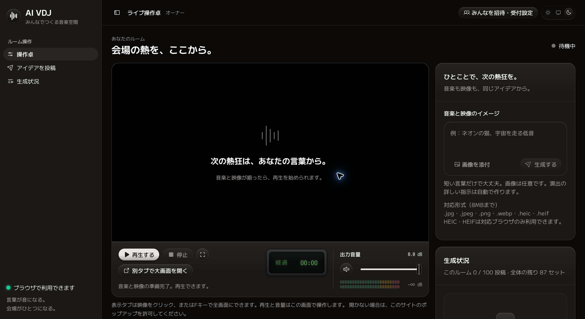
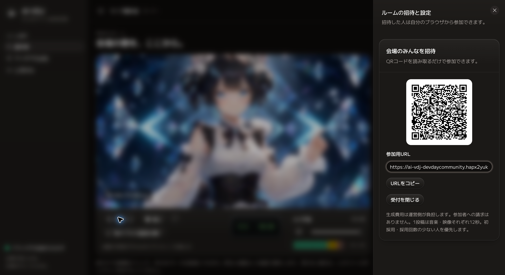
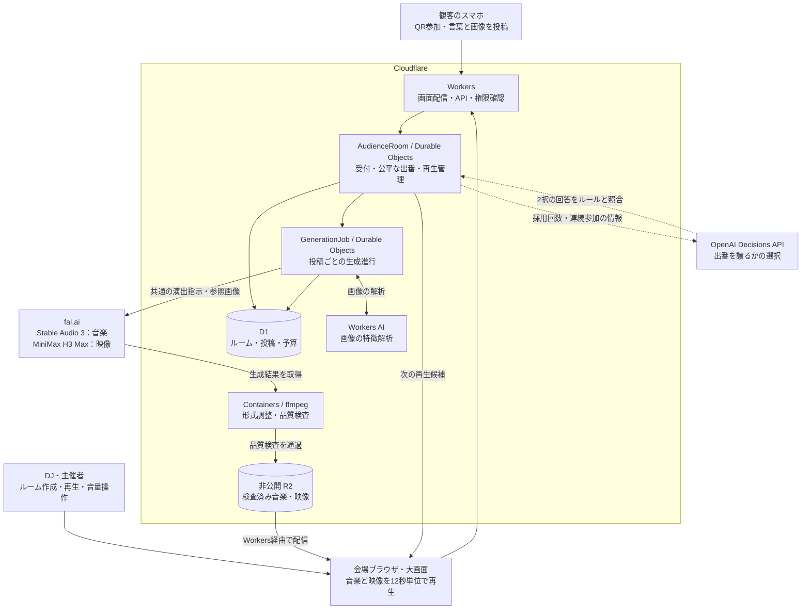

# AI VDJ

## あなたの「好き」が、<br>みんなの音楽と映像になる。

AI VDJは、観客がスマホから送った言葉や画像を、会場で流れる**12秒の音楽と映像**に変える参加型AI DJ・VJです。一人ひとりのアイデアを、ひとつの世界観と公平な出番で、みんなのショーにつなぎます。

- **QRから、ひとこと。** 専用アプリも難しい演出指示も不要。好きな画像も添えられます。
- **自分のアイデアが、大画面へ。** 音楽と映像を同じテーマから生成し、会場で一緒に楽しめます。
- **みんなに、出番を。** Decisions APIが、繰り返し参加した人から次の人へ出番を譲る進行を支えます。

**[▶ 会場を開いて体験する](https://ai-vdj-devdaycommunity.hapx2yuki.workers.dev/room)** · [アーキテクチャ](#アーキテクチャ) · [技術構成](#技術構成) · [コードと開発ガイド](#コードと開発ガイド)

会場用のPCと参加用のスマホで体験できます。1人でも試せます。会場側の再生はChromeを推奨しています。

## DJ / LIVE SHOWCASE


スマホから届く観客のアイデアと、会場で進行するDJ。同じ場所に集まった人たちが、音楽と映像を通してショーをつくります。

## 1. 新機能の活用 — Decisions APIで、みんなに出番を

**OpenAI DevDay 2026のDecisions APIを、「次に誰の作品を流すか」という会場の進行に組み込みました。** 新機能を使う目的は、参加者の出番が一部の人に偏らず、会場の演出も続く体験をつくることです。

基本は受付順です。全員に一巡する出番をつくるため、再生可能な投稿の中で採用回数の少ない参加者を優先し、同じ回数なら受付順を守ります。同じ人が続く場面では、ほかの参加者へ出番を譲ります。譲った投稿はキューに残り、後から再生されます。

全件が再生可能な状態なら、たとえば次のように進みます。

```text
投稿の順番  A1 → A2 → B1 → C1
再生の順番  A1 → B1 → C1 → A2
```

この繰り返し採用の調整に、`POST /v1/decisions`・`gpt-6-luna`の**choice形式**を使います。

| APIの役割 | 設計 |
| --- | --- |
| 入力 | 候補の採用回数、直前・次候補が同じ参加者かどうか。投稿文・画像・名前・参加者IDを含めない |
| 出力 | `PLAY_HEAD`（先頭を再生）／`DEFER_REPEAT`（繰り返し分を後へ）の2択 |
| 判断の範囲 | 出番を譲るかどうか。作品の内容や人気による順位付けは行わない |
| 体験への組み込み | 現在の映像を流している間に問い合わせ、回答をアプリの公平ルールと照合。次の再生予約はAPIを待たずに進む |

通常の順番で進められる場面ではAPIを呼びません。回答が間に合わない場合も同じ公平ルールで進み、参加者が1人なら続けて楽しめます。**新しい判断APIを、観客の参加機会と連続再生を守る役割に絞って活用しています。**

[Decisions APIの実装](cloud/cloudflare/playback-decisions.mjs) · [公平な再生順の実装](cloud/cloudflare/playback-queue.mjs)

## 2. 使いやすさ — QRから、自分の12秒へ

**観客が考えるのは「何を会場に登場させたいか」だけ。** 音楽や映像の制作知識、専用アプリ、APIキーの入力は必要ありません。

1. **会場を開く。** 主催者がPCでルームを開き、QRを表示して再生を始めます。
2. **スマホで参加する。** 観客がQRを読み、参加ページを開きます。
3. **ひとこと送る。** たとえば「ネオンの街で踊る猫」。言葉だけでも、お気に入りの画像を添えても参加できます。
4. **みんなで楽しむ。** 生成と品質確認を終えた投稿が、12秒の出番として大画面に登場します。

スマホでは投稿と生成状況の確認に集中し、会場の画面では再生・停止・音量・全画面表示を操作できます。Reactとaudiocn-dsのデザインシステムで、参加者と主催者それぞれの操作をそろえています。

**12秒は作品の再生時間です。** 生成中は15組・合計180秒の待機セットで会場を演出し、準備できた作品を次の区切りにつなぎます。観客は待っている間も、ほかの人の作品や会場の音楽を楽しめます。

### 主催者の管理画面

再生・停止・音量調整と、アイデアの投稿・生成状況の確認を、一つの操作卓にまとめています。



### QRで招待・受付管理

QRコードや参加用URLで観客を招待し、同じ画面から投稿の受付も管理できます。



## 3. 有用性 — 集まった人の「好き」を、交流のきっかけに

**イベントに集まった一人ひとりの個性を、会場全体で共有できる体験に変えます。** 好きなキャラクター、思いついた言葉、自分らしい画像が音楽と映像になって登場することで、「あれを送ったのは誰？」という会話のきっかけをつくります。

| 使う場面 | AI VDJが提供する体験 |
| --- | --- |
| コミュニティイベント・勉強会の交流時間 | 自己紹介で話し切れない趣味や関心を、音楽と映像で共有する |
| 展示会・体験ブース | 来場者の入力が展示内容に加わり、自分の作品が登場する出番を楽しむ |
| 学園祭・社内イベント | 制作経験を問わず参加でき、同じ会場で互いのアイデアを楽しむ |

主催者は、ルーム作成、招待、生成状況の確認、上映までをブラウザで運営できます。ルームの受付と投稿ごとの生成処理を分離しているため、生成処理の完了を待たずに次の投稿を受け付けます。生成前の予算予約と重複生成の防止も組み込み、イベント単位で費用を管理できます。

観客にとっては**自分も演出に参加できる場所**、主催者にとっては**参加者同士の交流を生むコンテンツ**として使えます。

## 4. 独創性 — 一人ひとりの作品を、ひとつのショーに

**「みんなのアイデア」「会場の世界観」「公平な出番」を、一つの生成・再生体験として設計しました。**

- **音楽と映像を、同じアイデアから。** 投稿ごとに共通の演出方針を組み立て、音と映像の両方へ渡します。共通の制作指示をEDM／サイケトランス・140 BPM・A minorとし、投稿の個性を音色・モチーフ・動きへ反映します。
- **画像を、その世界で動く存在に。** 画像の特徴や画風を読み取り、image-to-videoの演出に反映します。被写体の動きに加えて、照明・影・反射・周囲の粒子との関わりまで指示し、会場の世界観へ組み込みます。
- **出番までを、作品の体験に。** 音楽と映像を12秒の組として扱い、同じ時計で再生します。順番と繰り返し参加を調整し、別々の人の投稿を一つのショーへつなぎます。

観客はアイデアを持ち込み、AIはそれを音楽と映像へ展開し、DJは会場で再生や音量を操作する。この役割の組み合わせが、**その場にいる人たちの投稿によって変わるライブ体験**を生みます。

[共通の世界観と画像演出の実装](cloud/cloudflare/creative-direction.mjs)

## アーキテクチャ

観客の投稿、AIによる生成、DJの操作、会場での上映を次の構成でつなぎます。Decisions APIへの問い合わせは、再生の進行と並行して行います。



図は主な処理とデータの流れを示しています。生成結果の取得・検査・保存は、投稿ごとの生成ジョブが管理します。

| 設計の要点 | 体験への効果 |
| --- | --- |
| 受付・再生管理と、投稿ごとの生成処理を分離 | 生成中も新しい参加者の投稿を受け付ける |
| 受付応答の前に処理待ちを永続化 | 会場の操作画面を離れても、受け付けた生成処理を進める |
| 形式・音量の調整と映像の品質検査 | 音楽と映像を会場で再生する組としてそろえる |
| Web Audio API・HTML video・Canvas | 共通の再生時計で音と映像を切り替え、音に反応する描画を重ねる |
| Decisions APIの事前問い合わせと回答検証 | 公平な出番を保ちながら、APIの応答待ちで次の再生を止めない |

## 技術構成

| 担当 | 技術・実装 |
| --- | --- |
| 画面とAPI | React 19.2、audiocn-ds、Tailwind CSS v4、Base UI、Cloudflare Workers |
| ルーム・投稿・費用予約 | Cloudflare D1 |
| 受付・公平な再生順／投稿ごとの生成処理 | Cloudflare Durable Objectsを分離して管理 |
| 繰り返し採用時の選択 | OpenAI Decisions API / `gpt-6-luna` / `choice`。固定ルールで検証し、失敗時は即座に代替 |
| 画像の特徴解析 | Cloudflare Workers AI / Moondream |
| 音楽生成 | fal.ai / Stable Audio 3 |
| 映像生成 | fal.ai / MiniMax H3 Max。画像の有無で生成方法を切り替え |
| 形式調整と検査 | Cloudflare Containers / Node.js・Python・ffmpeg |
| 素材の保存 | 非公開のCloudflare R2 |
| 曲と映像の連続再生 | Web Audio API、HTML video、Canvas |

生成モデルとクラウド側の処理はサービスが管理します。利用者の端末は、ブラウザで投稿や再生を担当します。

## コードと開発ガイド

- [参加・招待・操作卓の使い方](docs/usage.md)
- [開発手順とディレクトリ案内](docs/development.md)
- [12秒セットの生成・再生設計](docs/audience-twelve-second.md)
- [Decisions APIと公平な再生順のテスト](tests/playback-decisions.test.mjs)
- [同時投稿・生成処理のテスト](tests/audience-queue.test.mjs)

同梱ライブラリのライセンスは[THIRD_PARTY_NOTICES.md](THIRD_PARTY_NOTICES.md)、操作画面の利用部品は[console/THIRD_PARTY.md](room-web/console/THIRD_PARTY.md)を参照してください。

**[あなたの「好き」を、会場へ。](https://ai-vdj-devdaycommunity.hapx2yuki.workers.dev/room)**
